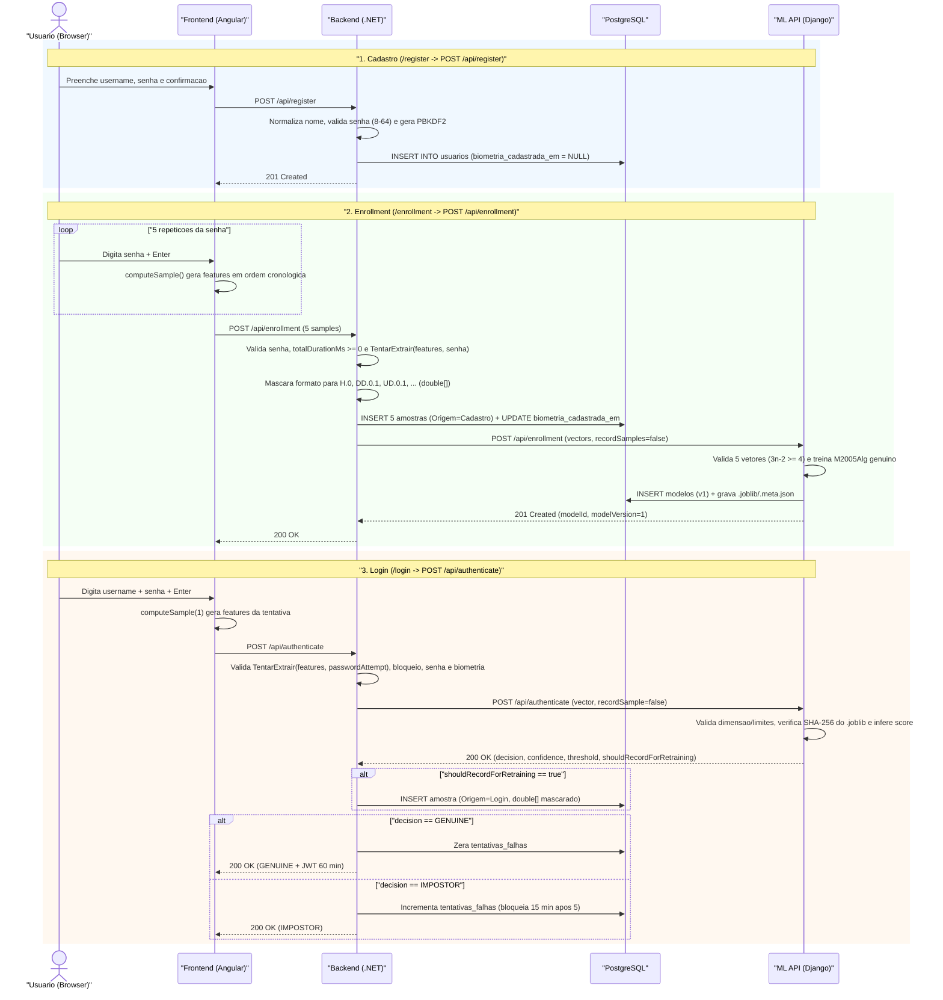

# Fluxo de Cadastro, Enrollment e Login

Documentação detalhada da comunicação, persistência e validações entre **Frontend (`projeto_si_frontend`)**, **Backend .NET (`projeto-si-backend`)** e **ML API (`projeto_si_ml_api`)** após a remoção de impostores sintéticos, desacoplamento do cadastro/senha na ML API e validação/mascaramento de `features` no backend.

---

## Visão Geral dos Módulos

| Módulo | Responsabilidades no Fluxo | Acesso ao Banco (`projeto_si`) |
|---|---|---|
| `projeto_si_frontend` (Angular 18) | UI (`/register`, `/enrollment`, `/login`), captura de teclas (`KEY_DOWN`/`KEY_UP`), cálculo local de `features` (`computeSample`) e roteamento de sessão (`/session` ou `/blocked`). | Nenhum (envia requisições `/api/*` via proxy para o Backend .NET). |
| `projeto-si-backend` (.NET 10) | Ponto de entrada `/api/*`, cadastro e hash de senha (`PBKDF2-HMAC-SHA512`), bloqueio por tentativas, validação das `features` contra a senha esperada, mascaramento posicional, persistência em `usuarios`/`amostras` e emissão de JWT. | Leitura e escrita em `usuarios` e `amostras`. |
| `projeto_si_ml_api` (Django + DRF) | Treinamento inicial (`M2005Alg` *one-class*, somente amostras genuínas), inferência biométrica, sinalização `shouldRecordForRetraining` e retreinamento periódico (`run_scheduler` / `retrain_models`). Não lê nem verifica senhas e não expõe `/api/register`. | Leitura de `usuarios` e `amostras`; escrita apenas em `modelos` (+ `.joblib`/SHA-256 em disco). |

---

## 1. Fluxo de Cadastro de Usuário (`/register` → `POST /api/register`)

### 1.1. Frontend (`RegisterComponent` e `BiometricApiService`)
- **Arquivo:** `projeto_si_frontend/src/app/features/register/register.component.ts` e `src/app/core/services/biometric-api.service.ts`.
- **Validações locais no `onSubmit()`:**
  - `username.trim()` não pode ser vazio.
  - `password` não pode ser vazio e deve ter `password.length >= 4`.
  - `password === confirmPassword`.
- **Requisição enviada:** `POST /api/register` com `{ username: this.username.trim(), targetPassword: this.password, confirmPassword: this.confirmPassword }`.
- **Pós-resposta (`201`):** salva usuário e senha-alvo em memória no `UserSessionService` (`registerUser`) e navega para `/enrollment`.

### 1.2. Backend .NET (`CadastrarUsuario`)
- **Arquivo:** `projeto-si-backend/src/ProjetoSi.Api/Features/Cadastro/CadastrarUsuario.cs` e `src/ProjetoSi.Api/Domain/NomeUsuario.cs`.
- **Validações:**
  - `Username` não vazio após espaços e `TargetPassword` não vazio.
  - Normaliza `Username` (`Trim().ToLowerInvariant()`) e exige regex `^[a-z0-9._@+-]{3,50}$` (`400 BadRequest` se inválido).
  - Tamanho de `TargetPassword` entre `TamanhoMinimoSenha = 8` e `TamanhoMaximoSenha = 64` caracteres (`400`).
  - `TargetPassword == ConfirmPassword` (`400`).
  - Unicidade de `Nome` em `usuarios` (`409 Conflict` se já existir ou ocorrer `UniqueViolation` no PostgreSQL).
- **Persistência e resposta:** gera o hash com `IPasswordHasher<Usuario>` (ASP.NET Identity `PBKDF2`), cria o registro em `usuarios` (`BiometriaCadastradaEm = null`, `DataMudancaSenha = agora`) e retorna `201 Created`.

### 1.3. API de ML
- **Arquivo:** `projeto_si_ml_api/biometrics/urls.py`.
- A ML API **não** possui endpoint de registro (`POST /api/register` retorna `404`), não armazena nem lê `senha_hash` e assume que o usuário já foi criado pelo `projeto-si-backend` na tabela `usuarios`.

---

## 2. Fluxo de Enrollment Biométrico (`/enrollment` → `POST /api/enrollment`)

### 2.1. Captura e Montagem da Requisição no Frontend
- **Arquivos:**
  - `projeto_si_frontend/src/app/shared/components/keystroke-input/keystroke-input.component.ts`
  - `projeto_si_frontend/src/app/core/services/keystroke-capture.service.ts`
  - `projeto_si_frontend/src/app/features/enrollment/enrollment.component.ts`
- **Captura (`KeystrokeInputComponent` + `KeystrokeCaptureService`):**
  - Ao focar o campo (`onFocus`), inicia a captura (`startRecording`).
  - No `paste` (`handlePaste`), bloqueia a colagem (`preventDefault()`), reseta o buffer e define `lastAnomaly`.
  - No `keydown` (`handleKeyDown`):
    - Ignora repetições de tecla segurada (`event.repeat`).
    - Reseta o buffer e registra anomalia caso o usuário pressione `Backspace`, `Delete`, `ArrowLeft`, `ArrowRight`, `ArrowUp`, `ArrowDown`, `Home` ou `End`.
    - Ignora teclas modificadoras (`Shift`, `Control`, `Alt`, `Meta`, `CapsLock`).
    - Registra `{ key, code, timestamp: performance.now(), eventType: 'KEY_DOWN' }` e concatena `event.key` em `currentText`.
  - No `keyup` (`handleKeyUp`), ignorando modificadores e `Enter`, registra `{ key, code, timestamp: performance.now(), eventType: 'KEY_UP' }`.
  - Ao pressionar `Enter` com `currentText.length > 0`, `KeystrokeInputComponent` emite `textSubmitted`.
- **Extração (`computeSample(repetition, targetPassword)`):**
  - Exige `textEntered.length > 0` e `textEntered === targetPassword`.
  - Exige `keyEventLog.length === textEntered.length * 2` e alternância estrita `KEY_DOWN(i) → KEY_UP(i+1) → KEY_DOWN(i+2)` (rejeita sobreposição de teclas / `UD < 0`).
  - Normaliza nomes de tecla via `normalizeKeyName(key)`: `'.' → 'period'`, `'5' → 'five'`, `'Enter' → 'Return'`, `'A'..'Z' → 'Shift.' + minúscula`.
  - Calcula as features em segundos (`toFixed(4)`) na ordem cronológica de digitação:
    `H.<k0>.0, DD.<k0>.<k1>.0, UD.<k0>.<k1>.0, H.<k1>.<cnt>, ..., H.<k_{n-1}>.<cnt>`
    e calcula `totalDurationMs` (`toFixed(2)`).
  - Retorna `KeystrokeSample`: `{ repetition, features, rawTimings, textEntered, totalDurationMs }`.
- **Envio (`EnrollmentComponent`):**
  - Coleta `totalRequiredRepetitions = 5` repetições válidas.
  - Envia `POST /api/enrollment` com `{ username, passwordLength, samplesCount, samples }`.

### 2.2. Validação, Mascaramento e Persistência no Backend .NET
- **Arquivos:**
  - `projeto-si-backend/src/ProjetoSi.Api/Common/Biometria/AmostraDigitacaoRequest.cs`
  - `projeto-si-backend/src/ProjetoSi.Api/Common/Biometria/VetorCaracteristicas.cs`
  - `projeto-si-backend/src/ProjetoSi.Api/Features/Cadastro/RegistrarAmostrasCadastro.cs`
  - `projeto-si-backend/src/ProjetoSi.Api/Common/Biometria/VerificadorBiometricoMlApi.cs`
- **Validações da requisição (`RegistrarAmostrasCadastro`):**
  - `Username` obrigatório (`400`).
  - `Samples` deve conter exatamente `Biometria:AmostrasCadastro` (`5` em `appsettings.json`) itens (`400`).
  - Todas as amostras devem possuir o mesmo `TextEntered` não vazio (`senhaDigitada`) (`400`).
  - `rawTimings` é ignorado na desserialização (`AmostraDigitacaoRequest` recebe apenas `Repetition`, `Features`, `TextEntered`, `TotalDurationMs`).
  - Para cada amostra:
    - `TotalDurationMs` deve ser finito e `>= 0` (`400`).
    - `VetorCaracteristicas.TentarExtrair(amostra.Features, senhaDigitada, out var vetor)` valida (`400` se falhar):
      - `senhaDigitada.Length` entre `MinimoTeclas = 2` e `MaximoTeclas = 128`;
      - `DeterminarIntervalosEsperados(senhaDigitada)` gera a sequência exata de `3n - 2` chaves esperada por `computeSample`;
      - `Features.Count == esperadas.Count` e cada chave na ordem da requisição corresponde exatamente a `esperadas[indice]` (`StringComparer.Ordinal`);
      - cada valor é finito (`double.IsFinite`), com `H` e `DD` em `(0, 5]` segundos e `UD` em `[-5, 5]` segundos.
- **Validações de estado e credencial do usuário:**
  - Busca usuário por `NomeUsuario.Normalizar(request.Username)`.
  - Se `PossuiBiometria == true`: retorna `409 Conflict`.
  - Se `EstaBloqueado(agora)`: retorna `401 Unauthorized`.
  - Verifica `verificadorSenha.Verificar(usuario, senhaDigitada)`: se falhar e o usuário existir, contabiliza falha (`RegistrarFalha`) e retorna `401 Unauthorized`.
- **Mascaramento e persistência em banco (`amostras`):**
  - `VetorCaracteristicas.FormatoMascarado` (`FormatoPosicionalPara`) mapeia as dimensões para o formato posicional `H.0, DD.0.1, UD.0.1, H.1, ..., H.{n-1}`, removendo letras e padrões de repetição.
  - `Amostra.DeCadastro` grava no PostgreSQL apenas `Vetor = vetor.Valores` (`double precision[]`), `Origem = Cadastro`, `Repeticao`, `DuracaoTotalMs` e `ColetadaEm` — sem nunca gravar chaves nominais, caracteres da senha ou `rawTimings`.
  - Atualiza `BiometriaCadastradaEm = agora`, zera falhas (`RegistrarSucesso`) e salva no PostgreSQL.
- **Chamada à ML API:** envia `POST /api/enrollment` para a ML API com `{ username, userId, vectors, recordSamples: false }` (apenas os `5` vetores numéricos puros).

### 2.3. Treinamento Inicial na API de ML (`POST /api/enrollment`)
- **Arquivos:** `projeto_si_ml_api/biometrics/serializers.py`, `biometrics/views.py`, `biometrics/services.py`, `biometrics/ml/features.py`, `biometrics/ml/training.py`, `biometrics/ml/registry.py`.
- **Validações:**
  - `EnrollmentRequestSerializer` exige `username` ou `userId` (`400`).
  - `enroll_user` verifica existência de `Usuario` (`404`) e ausência de `ModeloBiometrico` para `criado_em >= user.data_mudanca_senha` (`409`).
  - Valida os `5` (`ENROLLMENT_SAMPLES`) vetores recebidos via `validate_vector`: tamanho `>= 4` com `(len + 2) % 3 == 0` (`3n - 2`), finitos, mesma dimensão entre si, `H, DD ∈ (0, 5]` e `UD ∈ [-5, 5]` (`400`). (Também aceita `samples` com `features`/`rawTimings` ou fallback de leitura em `amostras` caso chamada diretamente sem `vectors`.)
- **Treinamento e persistência:**
  - Constrói schema posicional `H.0, DD.0.1, UD.0.1, ...` (`positional_schema`) e treina `M2005Alg` (`window_strategy="sliding"`, `window_size=50`, `threshold_method="min_non_outlier"`, `dynamic_threshold=True`, `threshold=0.7`) **exclusivamente com os vetores genuínos**, sem geração de impostores sintéticos.
  - Salva `.joblib` com hash SHA-256 embutido no nome, `.meta.json`, `active_version.json` e o registro `v1` na tabela `modelos`, retornando `201 Created`.
  - **Não** escreve em `amostras` e **não** altera `usuarios`.

---

## 3. Fluxo de Login e Retreinamento (`/login` → `POST /api/authenticate`)

### 3.1. Captura no Frontend (`LoginComponent`)
- **Arquivos:** `projeto_si_frontend/src/app/features/login/login.component.ts` e `src/app/core/services/auth.service.ts`.
- Ao submeter (`Enter` no `KeystrokeInputComponent` ou clique de login), chama `captureService.computeSample(1)` (sem `targetPassword`, validando a integridade local da digitação).
- Envia `POST /api/authenticate` com `{ username, passwordAttempt, sample }`.
- Se `decision === 'GENUINE'`, grava a sessão no `localStorage` (`keystrokeAuthSession`) e navega para `/session` (protegida por `authGuard`); se `decision === 'IMPOSTOR'`, registra tentativa bloqueada e navega para `/blocked` (protegida por `blockedAttemptGuard`).

### 3.2. Validação, Orquestração e Persistência Seletiva no Backend .NET
- **Arquivos:** `projeto-si-backend/src/ProjetoSi.Api/Features/Login/Autenticar.cs` e `src/ProjetoSi.Api/Common/Biometria/VerificadorBiometricoMlApi.cs`.
- **Validações da requisição (`Autenticar`):**
  - `Username` e `PasswordAttempt` não vazios (`400`).
  - `Sample` presente com `TotalDurationMs` finito e `>= 0` (`400`).
  - Se `Sample.TextEntered` não for nulo/vazio, exige igualdade exata com `PasswordAttempt` (`StringComparison.Ordinal`) (`400`).
  - Executa `VetorCaracteristicas.TentarExtrair(amostra.Features, request.PasswordAttempt, out var tentativa)` para garantir chaves exatas, ordem cronológica correta para `PasswordAttempt` e limites `(0, 5]` / `[-5, 5]` (`400`).
- **Validações de segurança do usuário:**
  - Busca usuário por nome normalizado.
  - Se bloqueado (`EstaBloqueado(agora)` — `MaximoTentativas = 5`, `MinutosBloqueio = 15`), se `verificadorSenha.Verificar` falhar (contabilizando falha) ou se `!usuario.PossuiBiometria`: retorna `200 OK` com `decision: "INVALID_CREDENTIALS"`.
- **Chamada à ML API e persistência condicional:**
  - Envia `POST /api/authenticate` para a ML API com `{ username, userId, vector: tentativa.Valores, recordSample: false }`.
  - Lê `shouldRecordForRetraining` (`DeveGravarParaRetreino`) da resposta da ML API e **só adiciona** `Amostra.DeLogin` em `amostras` (apenas o `double[]` posicional mascarado, `DuracaoTotalMs`, `Decisao`, `Confianca` e `ModeloId`) quando `DeveGravarParaRetreino == true`.
  - Se `Decisao == Genuine`: chama `usuario.RegistrarSucesso()` e gera JWT (`GeradorToken`, `MinutosExpiracao = 60` em `appsettings.json`).
  - Se `Decisao == Impostor`: chama `usuario.RegistrarFalha(...)` (bloqueando por `15` min ao atingir `5` falhas).
  - Salva alterações no PostgreSQL (`409 Conflict` em `DbUpdateConcurrencyException`) e retorna `200 OK` com `decision`, `confidenceScore`, `thresholdScore`, `inferenceTimeMs`, `message`, `userAverageHoldTimeMs`, `attemptAverageHoldTimeMs`, `accessToken` e `accessTokenExpiresAt`.

### 3.3. Inferência e Elegibilidade na API de ML (`POST /api/authenticate`)
- **Arquivos:** `projeto_si_ml_api/biometrics/serializers.py`, `biometrics/views.py`, `biometrics/services.py`, `biometrics/ml/inference.py`, `config/settings.py`.
- **Proteção e validações:**
  - Rate limit `ScopedRateThrottle` (`authenticate`, padrão `120/minute`).
  - `AuthenticateRequestSerializer` exige `username` ou `userId` e pelo menos um entre `vector`, `features` ou `rawTimings` (`400`).
  - `authenticate_user` não lê nem verifica senha; verifica existência de `Usuario` (`404`) e de `ModeloBiometrico` ativo para `criado_em >= data_mudanca_senha` (`409`).
  - Carrega o modelo via `load_model` validando o **hash SHA-256** do arquivo `.joblib` antes da desserialização (`500` se adulterado).
  - Valida `vector` com `validate_vector` (`3n - 2 >= 4` e limites por slot) e verifica se `len(pos_vector) == len(estimator.feature_names_)` (`400` se incompatível; quando chamada diretamente com `features`, exige também ordem/chaves exatas).
- **Classificação e retorno:**
  - Classifica apenas contra o perfil genuíno (`M2005Alg`), calcula `sample_label = label_for(confidence, threshold)` com margem `LABEL_CONFIDENCE_MARGIN = 0.15` em torno do limiar do modelo (`DECISION_THRESHOLD = 0.7`):
    - `GENUINE` se `confidence >= threshold + 0.15`;
    - `IMPOSTOR` se `confidence <= threshold - 0.15`;
    - `UNCERTAIN` na faixa intermediária.
  - Define `shouldRecordForRetraining = (decision == "GENUINE" and sample_label == "GENUINE")` e retorna `200 OK` **sem escrever nada em `amostras`**.

### 3.4. Retreinamento Adaptativo (`run_scheduler` / `retrain_models`)
- **Arquivos:** `projeto_si_ml_api/biometrics/management/commands/run_scheduler.py`, `retrain_models.py`, `biometrics/services.py`.
- O worker `run_scheduler` executa periodicamente a cada `RETRAIN_INTERVAL_MINUTES = 60` minutos (também acionável via `python manage.py retrain_models`).
- `retrain_user` adquire lock concorrente (`select_for_update(skip_locked=True)`) e **apenas consulta** `amostras` (`coletada_em >= data_mudanca_senha`):
  - Sem `--force`, exige pelo menos `RETRAIN_MIN_NEW_SAMPLES = 5` novas amostras `Login` com `decisao = "Genuine"` e `confianca >= base_threshold + 0.15` posteriores ao `criado_em` do modelo ativo.
  - Seleciona a janela deslizante de até `RETRAIN_GENUINE_WINDOW = 50` amostras mais recentes dentre `Cadastro` e `Login` elegíveis (`Genuine` de alta confiança), ignorando amostras `Impostor` e incertas.
  - Reajusta o `M2005Alg` (`sliding` + `min_non_outlier`) e persiste a próxima versão em `modelos` + `.joblib`/SHA-256 + `active_version.json`.

---

## Pontos de Atenção Atuais no Contrato Entre Módulos

- **Tamanho mínimo de senha no cadastro:** o frontend (`RegisterComponent`) aceita `>= 4` caracteres, mas o backend (`CadastrarUsuario`) exige `8` a `64` caracteres (`400 BadRequest` para senhas de `4` a `7` caracteres).
- **Sobreposição de teclas (`UD < 0`):** `KeystrokeCaptureService.computeSample` bloqueia localmente digitação sobreposta exigindo `KEY_DOWN → KEY_UP → KEY_DOWN`, embora o backend (`VetorCaracteristicas.TentarExtrair`) e a ML API (`validate_vector`) aceitem `UD ∈ [-5, 5]` segundos.
- **Campo `rawTimings` no payload:** o frontend continua incluindo `rawTimings` em `KeystrokeSample`, mas `AmostraDigitacaoRequest` no backend ignora esse campo e utiliza exclusivamente `Features` (validado contra a senha) e `TotalDurationMs`.
